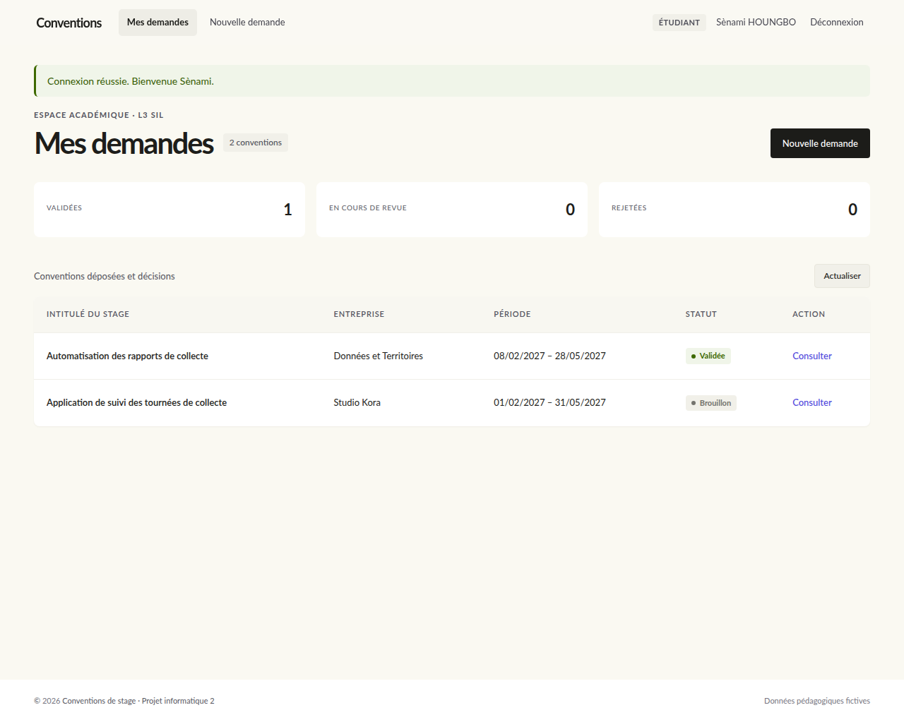
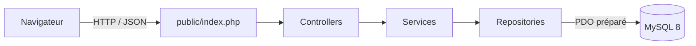

# Plateforme de suivi des conventions de stage et des soutenances


Application Web locale de gestion des demandes de stage : dépôt d'une convention par
l'étudiant, suivi de son statut, validation ou refus motivé par le responsable
pédagogique, consultation des dossiers selon le rôle. Le tout avec une API JSON, une
interface accessible et une base MySQL, sans framework ni dépendance externe.

**Projet informatique 2 — L3 SIL** · OUSSOU Hermax, TCHEGNON Loïk, KANHONOU Ashley ·
Encadreur : MAMA Tairou · 2026



---

## Sommaire

- [1. Fonctionnalités](#1-fonctionnalités)
- [2. Stack et architecture](#2-stack-et-architecture)
- [3. Prérequis](#3-prérequis)
- [4. Installation pas à pas](#4-installation-pas-à-pas)
- [5. Comptes de démonstration](#5-comptes-de-démonstration)
- [6. Utilisation](#6-utilisation)
- [7. Tests](#7-tests)
- [8. Sauvegarde et restauration](#8-sauvegarde-et-restauration)
- [9. Structure du dépôt](#9-structure-du-dépôt)
- [10. Documentation par TP](#10-documentation-par-tp)
- [11. Limites connues et version 2](#11-limites-connues-et-version-2)
- [12. Dépannage](#12-dépannage)
- [13. Sécurité et données](#13-sécurité-et-données)

---

## 1. Fonctionnalités

| Rôle | Ce qu'il peut faire |
|---|---|
| **ETUDIANT** | Créer une convention (entreprise, intitulé, dates), la soumettre, consulter ses demandes et leur statut. |
| **RESPONSABLE** | Rechercher et filtrer les dossiers, valider une demande ou la refuser avec un motif obligatoire. |
| **ENCADREUR** | Consulter les demandes qu'il encadre, sans pouvoir décider. |
| **ADMIN** | Consulter tous les dossiers, sans bouton de décision. |
| **DEVELOPPEUR** | Compte technique du jeu d'essai, sans écran dédié. |

Règles métier principales :

- cycle de vie `BROUILLON → SOUMISE → VALIDEE | REFUSEE` ; les deux derniers états sont terminaux ;
- un refus exige un motif de 3 à 255 caractères ;
- la décision est une transaction : mise à jour du statut **et** écriture dans l'historique, avec rollback en cas d'échec ;
- un étudiant ne voit que ses propres demandes ; un encadreur, que celles qu'il encadre ;
- les contrôles d'accès et de rôle sont faits côté serveur, jamais dans le navigateur ;
- toutes les données sont **fictives**.

## 2. Stack et architecture

- **PHP 8.1+** sans framework, autoload PSR-4 minimal ;
- **MySQL 8 / MariaDB** avec requêtes préparées PDO ;
- **API JSON** et interface servie par la même application (même origine, même session) ;
- **HTML/CSS/JavaScript** natifs, rendu par `textContent` (pas de `innerHTML`).



| Couche | Responsabilité |
|---|---|
| `public/` | Point d'entrée, fichiers statiques, traduction des exceptions en réponses HTTP. |
| `Controllers/` | Lecture de la requête, appel du service, choix du code HTTP. |
| `Services/` | Règles métier, validation, autorisations, transactions. |
| `Repositories/` | SQL préparé, accès aux données, gestion des transactions. |
| `Support/` | Routeur, requête/réponse, session, CSRF, chargement de `.env`. |

## 3. Prérequis

| Outil | Version minimale | Vérification |
|---|---|---|
| PHP | 8.1 | `php -v` |
| Extension `pdo_mysql` | activée | `php -m \| grep pdo_mysql` |
| MySQL ou MariaDB | MySQL 8.0 / MariaDB 10.4 | `mysql --version` |
| Git | 2.x | `git --version` |
| curl | 7.x | `curl --version` |
| Navigateur | récent | Chrome, Firefox, Edge |

Sous Ubuntu, installer si besoin :

```bash
sudo apt update
sudo apt install php-cli php-mysql mysql-server git curl
```

## 4. Installation pas à pas

### 4.1. Cloner le dépôt

```bash
git clone https://github.com/oussouhermaxlouange-dotcom/Projet_Informatique.git
cd Projet_Informatique
```

### 4.2. Créer la base et charger le jeu d'essai

Le script `001_schema.sql` crée la base `tp3_conventions`, les 9 tables, les contraintes
et les 4 vues. Le script `002_seed.sql` charge les données fictives.

```bash
mysql -u root -p < TP3_Modele_donnees/001_schema.sql
mysql -u root -p < TP3_Modele_donnees/002_seed.sql
```

Si MySQL n'écoute qu'en socket Unix, préciser le socket :

```bash
mysql -u root -p --socket=/var/run/mysqld/mysqld.sock \
      < TP3_Modele_donnees/001_schema.sql
mysql -u root -p --socket=/var/run/mysqld/mysqld.sock \
      < TP3_Modele_donnees/002_seed.sql
```

Contrôle rapide :

```bash
mysql -u root -p -e "SELECT COUNT(*) FROM tp3_conventions.convention;"
# attendu : 6
```

### 4.3. Créer un compte SQL dédié

Ne pas utiliser `root` pour l'application. Créer un compte limité à la base du projet :

```bash
mysql -u root -p <<'SQL'
CREATE USER IF NOT EXISTS 'tp4_app'@'localhost'
  IDENTIFIED BY 'ChangezMoi2026';
GRANT SELECT, INSERT, UPDATE, DELETE
  ON tp3_conventions.* TO 'tp4_app'@'localhost';
FLUSH PRIVILEGES;
SQL
```

Ce compte ne peut pas modifier le schéma : `DROP`, `CREATE`, `ALTER` et `GRANT` sont
refusés (`ERROR 1142`). C'est volontaire.

### 4.4. Configurer l'application

```bash
cd TP4_Architecture
cp .env.example .env
```

Renseigner `.env` :

```ini
APP_ENV=local
APP_DEBUG=false

DB_HOST=127.0.0.1
DB_PORT=3306
DB_NAME=tp3_conventions
DB_USER=tp4_app
DB_PASSWORD=ChangezMoi2026

# Socket Unix optionnel : s'il est renseigné, il remplace host/port.
DB_SOCKET=
```

Points importants :

- `.env` n'est **jamais** versionné (`.gitignore`) ;
- si `DB_SOCKET` est renseigné, il est **prioritaire** sur `DB_HOST` et `DB_PORT` ;
- vérifier que le socket existe sur **ce poste** avant de l'utiliser :

```bash
test -S /var/run/mysqld/mysqld.sock && echo "socket présent"
```

### 4.5. Lancer le serveur

```bash
php -S 127.0.0.1:8000 -t public public/index.php
```

Ouvrir ensuite **<http://127.0.0.1:8000/>**.

Avec Apache, faire pointer le `DocumentRoot` sur `TP4_Architecture/public/` ; le fichier
`.htaccess` réécrit les requêtes vers `index.php`.

### 4.6. Vérifier l'installation

```bash
curl -sS http://127.0.0.1:8000/api/sante
```

Réponse attendue lorsque la base est joignable :

```json
{"statut":"ok","base":"ok","horodatage":"2026-11-20T12:34:18+00:00"}
```

Tester aussi la connexion :

```bash
curl -sS -c /tmp/cookies.txt \
  -H 'Content-Type: application/json' \
  -d '{"email":"sena.houngbo@univ.test","mot_de_passe":"Demo1234!"}' \
  http://127.0.0.1:8000/api/connexion
```

## 5. Comptes de démonstration

Mot de passe commun : **`Demo1234!`**

| Rôle | E-mail | Usage |
|---|---|---|
| Étudiant | `sena.houngbo@univ.test` | Déposer et suivre une demande |
| Étudiant | `ibrahim.sanni@univ.test` | Tester le refus d'accès au dossier d'un autre étudiant |
| Encadreur | `sylvain.kiki@univ.test` | Consulter les demandes encadrées |
| Responsable | `responsable.pedago@univ.test` | Valider ou refuser avec motif |
| Admin | `admin.siege@univ.test` | Consulter tous les dossiers |
| Développeur | `dev.equipe@univ.test` | Compte technique |

## 6. Utilisation

### Parcours étudiant

1. Se connecter avec `sena.houngbo@univ.test`.
2. Cliquer sur **Nouvelle demande**.
3. Choisir une entreprise, saisir un intitulé et des dates cohérentes (`fin > début`).
4. Soumettre : la demande passe en `SOUMISE` et apparaît dans **Mes demandes**.

### Parcours responsable

1. Se connecter avec `responsable.pedago@univ.test`.
2. Ouvrir **Dossiers à traiter**, rechercher ou filtrer par statut.
3. Ouvrir un dossier, puis **Valider** ou **Refuser**.
4. Un refus sans motif est bloqué par le serveur (`422`) et signalé sous le champ.

### API

| Méthode | Chemin | Accès |
|---|---|---|
| `GET` | `/api/sante` | Public |
| `POST` | `/api/connexion` | Public |
| `POST` | `/api/deconnexion` | Session |
| `GET` | `/api/moi` | Session |
| `GET` | `/api/demandes` | Session, selon le rôle |
| `GET` | `/api/demandes/{id}` | Session + droits |
| `POST` | `/api/demandes` | Étudiant |
| `PATCH` | `/api/demandes/{id}/statut` | Responsable |

Contrat complet : [`TP4_Architecture/docs/contrat_api.md`](TP4_Architecture/docs/contrat_api.md).

## 7. Tests

### 7.1. Vérifications sans HTTP

```bash
cd TP4_Architecture
php tests/test_connexion.php   # connexion PDO
php tests/test_sante.php       # route de santé
php tests/test_routes.php      # routeur, 401/404/405
php tests/test_domain.php      # transitions, rollback, autorisations
```

### 7.2. Rejeu de l'API et des scénarios HTTP

```bash
cd TP4_Architecture
./tests/tester_api.sh http://127.0.0.1:8000
./tests/tester_http.sh http://127.0.0.1:8000
```

### 7.3. Matrice de sécurité TP8

```bash
cd TP8_Tests
./tests_securite.sh
```

Le script recharge la base, démarre l'API sur le port `8086` et rejoue **14 tests** :
cas limites, autorisations, injection, CSRF, données hostiles, hachage.

> **Attention** : les scripts TP6 et TP8 rechargent `001_schema.sql` et `002_seed.sql`.
> Ils utilisent le `DB_USER` de `.env` et ont donc besoin d'un compte autorisé à créer et
> supprimer les tables (`root` ou un compte de test dédié). À lancer sur une **base de
> test**, jamais sur une base contenant des données à conserver. Remettre ensuite
> `DB_USER=tp4_app` pour l'usage normal.

### 7.4. Scénario manuel TP7

Le parcours complet (connexion, création, validation, refus, persistance, XSS) est décrit
dans [`TP7_Frontend/scenario.md`](TP7_Frontend/scenario.md), avec 13 captures.

Résultats conservés :

- **14/14** tests TP8 conformes ;
- **8/8** mots de passe en bcrypt ;
- **5/5** scénarios de recette conformes ;
- **9/9** tables restaurées à l'identique (TP9).

## 8. Sauvegarde et restauration

Sauvegarde cohérente, sans bloquer les écritures :

```bash
mysqldump -u root -p --single-transaction --routines --triggers \
  tp3_conventions > tp3_conventions_$(date +%F).sql
sha256sum tp3_conventions_$(date +%F).sql
```

Restauration **sur une base de test** :

```bash
mysql -u root -p -e "
  CREATE DATABASE tp3_conventions_restauration
  CHARACTER SET utf8mb4 COLLATE utf8mb4_unicode_ci;"

mysql -u root -p tp3_conventions_restauration \
  < tp3_conventions_2026-11-20.sql
```

Comparer les comptages des deux bases, table par table. Une sauvegarde n'est fiable
qu'après une **restauration réussie**. Procédure détaillée et preuves :
[`TP9_Deploiement/README.md`](TP9_Deploiement/README.md).

## 9. Structure du dépôt

```text
Projet_Informatique/
├── README.md                     # ce fichier
├── RESUME_PROJET.md              # synthèse TP1 → TP10
├── TP1_Fiche_cadrage.md/.docx
├── TP2_Exigences.md/.docx
├── TP3_Modele_donnees/           # UML, schéma SQL, seed, vues, tests de contraintes
├── TP4_Architecture/             # application : API, interface, config, tests
├── TP6_API/                      # rejeu API, preuves, rapport
├── TP7_Frontend/                 # parcours, scénario, 13 captures, rapport
├── TP8_Tests/                    # matrice, revue de code, recette, rapport
├── TP9_Deploiement/              # installation, compte SQL, dump, ticket incident
├── TP10_Soutenance/              # dossier de livraison, démonstration, rétrospective
├── outils/                       # génération DOCX partagée
└── Maquette /                    # maquettes initiales
```

## 10. Documentation par TP

| TP | Livrable | Contenu |
|---|---|---|
| TP1 | [`TP1_Fiche_cadrage.md`](TP1_Fiche_cadrage.md) | Problème, acteurs, périmètre, objectifs SMART, risques |
| TP2 | [`TP2_Exigences.md`](TP2_Exigences.md) | 8 exigences fonctionnelles, 3 ENF, matrice de traçabilité |
| TP3 | [`TP3_Modele_donnees/`](TP3_Modele_donnees/) | Cas d'utilisation, classes, schéma SQL, vues, jeu d'essai |
| TP4 | [`TP4_Architecture/README.md`](TP4_Architecture/README.md) | Arborescence, configuration, ADR, contrat d'API |
| TP6 | [`TP6_API/`](TP6_API/) | Rejeu des cas API, preuves, rapport 2 pages |
| TP7 | [`TP7_Frontend/README.md`](TP7_Frontend/README.md) | Parcours, écrans, accessibilité, erreurs, captures |
| TP8 | [`TP8_Tests/README.md`](TP8_Tests/README.md) | Matrice de 14 tests, revue, recette, rapport |
| TP9 | [`TP9_Deploiement/README.md`](TP9_Deploiement/README.md) | Installation, droits SQL, sauvegarde/restauration, incident |
| TP10 | [`TP10_Soutenance/README.md`](TP10_Soutenance/README.md) | Dossier de livraison, démonstration 8 min, oral, bilan |

Synthèse générale : [`RESUME_PROJET.md`](RESUME_PROJET.md).

## 11. Limites connues et version 2

- **EF-05 — programmation de soutenance** : le modèle TP3 et les vues
  (`v_planning_soutenance`, `v_soutenances_conflits`) existent, mais l'API n'expose pas
  encore la création d'une soutenance. Prévu en version 2, avec refus `409` en cas de
  conflit de salle ou d'encadreur.
- **Rôles `ENCADREUR` et `DEVELOPPEUR`** : consultation uniquement, sans écran dédié.
- **Pas de migration évolutive** : les scripts SQL sont numérotés et rejouables, mais une
  évolution de schéma exigerait un script de migration.
- **Pas de limitation des tentatives de connexion** (R-04) : prévue avant toute mise en
  ligne (`429`, 5 essais / 15 minutes).
- **Hors périmètre MVP** : notifications, portail entreprise, import de pièces jointes.
- **Historique Git groupé par jalon** : la version 2 passe à un commit par fonctionnalité
  et par membre.

## 12. Dépannage

| Symptôme | Cause probable | Solution |
|---|---|---|
| `503` sur `/api/sante` | base injoignable, mauvais socket, identifiants incorrects | vérifier `.env`, `test -S`, `SHOW GRANTS`, journal PHP |
| `SQLSTATE[HY000] [2002] No such file or directory` | `DB_SOCKET` obsolète ou recopié d'un autre poste | vider `DB_SOCKET` ou mettre le socket réel |
| `1045 Access denied` | utilisateur ou mot de passe incorrect | recréer le compte, corriger `.env` |
| `1142 command denied` | compte applicatif sans droits DDL | normal pour `tp4_app` ; utiliser un compte de test pour recharger la base |
| `409 TRANSITION_INTERDITE` | demande déjà `VALIDEE` ou `REFUSEE` | état terminal, créer une nouvelle demande |
| `422 VALIDATION` | champ manquant, date invalide, refus sans motif | lire le détail renvoyé par l'API |
| Port `8000` occupé | autre serveur | `php -S 127.0.0.1:8081 -t public public/index.php` |
| Page sans style | mauvais `DocumentRoot` | servir depuis `public/`, pas depuis la racine |

En cas de `503`, le journal du serveur PHP donne la cause exacte (connexion PDO
refusée, socket absent, etc.). Ne modifier le code qu'après avoir vérifié la
configuration et les droits.

## 13. Sécurité et données

- `.env` exclu de Git ; seul `.env.example` est versionné, avec des valeurs factices ;
- mots de passe hachés en bcrypt (`password_hash` / `password_verify`), jamais en clair ;
- requêtes préparées avec `PDO::ATTR_EMULATE_PREPARES = false` ;
- aucun SQL dans les contrôleurs, aucune règle métier dans le HTML ;
- session `HttpOnly`, `SameSite=Lax`, identifiant régénéré à la connexion ;
- contrôle de l'en-tête `Origin` sur les écritures (`403 ORIGINE_REFUSEE`) ;
- rendu par `textContent` uniquement : aucune balise reçue de l'API n'est interprétée ;
- **aucune donnée réelle** : uniquement le jeu fictif du TP3.

---

## Équipe

| Membre | Contribution principale |
|---|---|
| **OUSSOU Hermax** | API, décisions, déploiement, sauvegarde/restauration |
| **TCHEGNON Loïk** | Modèle de données, interface, parcours utilisateurs |
| **KANHONOU Ashley** | Tests, sécurité, recette, analyse |

Encadreur : **MAMA Tairou** — Projet informatique 2, L3 SIL, 2026.

> Projet académique. Les données, comptes et scénarios sont fictifs et destinés à la
> démonstration locale.
